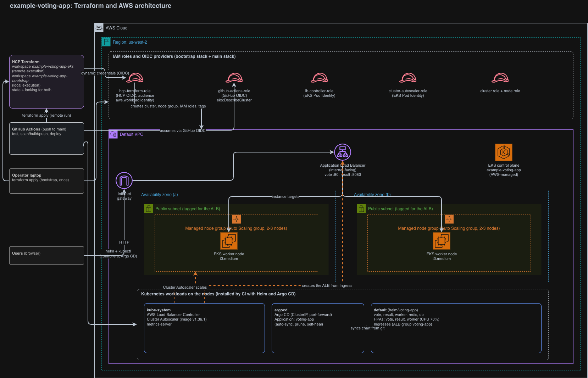

# Example Voting App

A simple distributed application running across multiple Docker containers.

## Getting started

Download [Docker Desktop](https://www.docker.com/products/docker-desktop) for Mac or Windows. [Docker Compose](https://docs.docker.com/compose) will be automatically installed. On Linux, make sure you have the latest version of [Compose](https://docs.docker.com/compose/install/).

This solution uses Python, Node.js, .NET, with Redis for messaging and Postgres for storage.

Run in this directory to build and run the app:

```shell
docker compose up
```

The `vote` app will be running at [http://localhost:8080](http://localhost:8080), and the `results` will be at [http://localhost:8081](http://localhost:8081).

Alternately, if you want to run it on a [Docker Swarm](https://docs.docker.com/engine/swarm/), first make sure you have a swarm. If you don't, run:

```shell
docker swarm init
```

Once you have your swarm, in this directory run:

```shell
docker stack deploy --compose-file docker-stack.yml vote
```

## Run the app in Kubernetes

The folder k8s-specifications contains the YAML specifications of the Voting App's services.

Run the following command to create the deployments and services. Note it will create these resources in your current namespace (`default` if you haven't changed it.)

```shell
kubectl create -f k8s-specifications/
```

The `vote` web app is then available on port 31000 on each host of the cluster, the `result` web app is available on port 31001.

To remove them, run:

```shell
kubectl delete -f k8s-specifications/
```

### Run the app with Helm

A Helm chart (`helm/voting-app`) packages the same services with one `values.yaml`:

```shell
helm install voting-app ./helm/voting-app
```

```shell
helm uninstall voting-app
```

### Deploy to AWS (EKS)

Terraform (in `terraform/`) provisions an EKS cluster in the default VPC, and
GitHub Actions (`.github/workflows/ci.yaml`) builds, scans, and deploys the
app to it on every push to `main`.

See [terraform-architecture.md](terraform-architecture.md) for the full AWS
and Terraform architecture diagram.



#### GitOps (Argo CD) and autoscaling

On EKS the app is deployed by Argo CD, not by `helm upgrade` from CI. CI installs
Argo CD, then applies `argocd/application.yaml`, which points Argo CD at
`helm/voting-app` on `main` (with `values-eks.yaml`) and passes the new image
tags as Helm parameters. Argo CD syncs automatically (prune + self-heal), and CI
waits for the Application to be Synced and Healthy. **The repo must be public**,
or you must give Argo CD credentials for it (`argocd repo add` / a repository secret).

Open the Argo CD UI (it's ClusterIP only):

```shell
kubectl port-forward svc/argocd-server -n argocd 8443:443
# https://localhost:8443, user: admin
kubectl -n argocd get secret argocd-initial-admin-secret -o jsonpath='{.data.password}' | base64 -d
```

Autoscaling, all installed by CI:
- **Pods:** metrics-server plus CPU-based HPAs for vote, result and worker
  (`helm/voting-app/values-eks.yaml`, target 70% of the CPU request).
- **Nodes:** Cluster Autoscaler scales the managed node group between
  `node_min_size` and `node_max_size` (default 2-3). Its image tag in
  `ci.yaml` must match the cluster's Kubernetes minor version.

Two t3.medium nodes are tight for Argo CD plus the app; if pods stay Pending,
raise `node_max_size` or the instance type.

#### Using this in your own AWS account

Nothing account-specific is committed, so to run it yourself:

1. **HCP Terraform:** create an organization and two CLI-driven workspaces,
   `example-voting-app-bootstrap` (execution mode **Local**) and
   `example-voting-app-eks` (execution mode **Remote**). Run `terraform login`.
2. **Bootstrap (once, from your machine with AWS credentials):**
   ```shell
   cd terraform/bootstrap
   cp terraform.tfvars.example terraform.tfvars   # set github_repository and hcp_organization
   export TF_CLOUD_ORGANIZATION=<your-hcp-org> TF_WORKSPACE=example-voting-app-bootstrap
   terraform init && terraform apply
   ```
3. **HCP workspace variables** on `example-voting-app-eks` (environment variables):
   `TFC_AWS_PROVIDER_AUTH=true` and `TFC_AWS_RUN_ROLE_ARN=<hcp_terraform_role_arn output>`.
4. **GitHub repository settings** (Settings > Secrets and variables > Actions):
   - Secret `TF_API_TOKEN`: an HCP Terraform API token.
   - Variables `AWS_ROLE_ARN` (the `github_actions_role_arn` output) and
     `TF_CLOUD_ORGANIZATION`. Optional: `AWS_REGION`, `CLUSTER_NAME` and
     `TF_WORKSPACE` (defaults: `us-west-2`, `example-voting-app`,
     `example-voting-app-eks`). If you change region or cluster name, set the
     same values as Terraform variables on the `-eks` workspace and in the
     bootstrap `terraform.tfvars`.
5. Push to `main`.

## Architecture


* A front-end web app in [Python](/vote) which lets you vote between two options
* A [Redis](https://hub.docker.com/_/redis/) which collects new votes
* A [.NET](/worker/) worker which consumes votes and stores them in…
* A [Postgres](https://hub.docker.com/_/postgres/) database backed by a Docker volume
* A [Node.js](/result) web app which shows the results of the voting in real time

## Notes

The voting application only accepts one vote per client browser. It does not register additional votes if a vote has already been submitted from a client.

This isn't an example of a properly architected perfectly designed distributed app... it's just a simple
example of the various types of pieces and languages you might see (queues, persistent data, etc), and how to
deal with them in Docker at a basic level.
