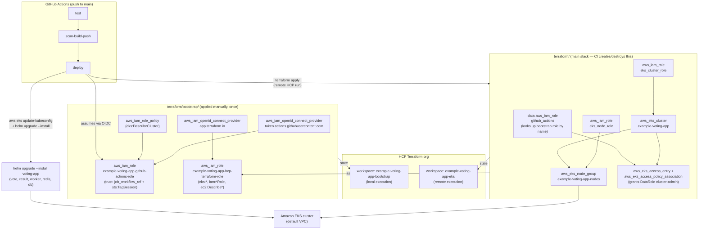

# Terraform Architecture

Two independent Terraform stacks keep state in HCP Terraform (your HCP org). `bootstrap/` is
applied once, manually, with real AWS credentials (its workspace uses local execution). `terraform/` (main) is
what CI creates and destroys on every push to `main` — it references the
bootstrap role by name, never owns it, so destroying the cluster never
breaks CI's own ability to authenticate.

## Why two stacks

AWS OIDC authentication requires the trust relationship (provider + role) to
already exist before a workflow can use it — CI cannot create its own
permission to talk to AWS. Splitting the state means:

- `terraform/bootstrap/` (OIDC provider, IAM role, inline policy) is rarely
  touched and never destroyed by CI.
- `terraform/` (cluster, node group, cluster/node IAM roles, access entries)
  is safe to create and destroy repeatedly — a full `terraform destroy` here
  never removes CI's ability to re-authenticate and rebuild.

## Trust policy notes

The role's trust policy anchors on `token.actions.githubusercontent.com:job_workflow_ref`
rather than the classic `sub` claim (`repo:owner/repo:ref:refs/heads/main`),
because repositories created after GitHub's immutable-ID rollout emit a
`sub` claim that doesn't match that string format at all. `job_workflow_ref`
(the calling workflow's file path + ref) is unaffected by that change and is
explicitly supported by AWS as an alternative anchor condition. The policy
also grants `sts:TagSession`, required because `aws-actions/configure-aws-credentials@v4`
passes GitHub context as session tags by default.
