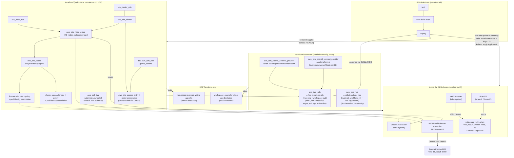

# Terraform Architecture

Two independent Terraform stacks keep state in HCP Terraform (your HCP org).
`bootstrap/` is applied once, manually, with real AWS credentials (its
workspace uses local execution). `terraform/` (main) runs **remotely on HCP**,
triggered by CI on every push to `main`. It references the bootstrap GitHub
role by name, never owns it, so destroying the cluster never breaks CI's own
ability to authenticate.

Everything that runs *inside* the cluster (load balancer controller, metrics,
autoscaler, Argo CD, the app) is installed by CI with Helm and Argo CD. Terraform
only provides the AWS side: IAM roles, Pod Identity associations and tags.

The diagram above is editable: open `terraform-architecture.drawio` in
[diagrams.net](https://app.diagrams.net) and re-export the PNG after changes.
The Mermaid version below shows the same flow in text form.

## Why two stacks

AWS OIDC authentication requires the trust relationship (provider + role) to
already exist before a workflow or HCP run can use it, so neither CI nor HCP
can create its own permission to talk to AWS. Splitting the state means:

- `terraform/bootstrap/` (both OIDC providers, the GitHub CI role and the HCP
  Terraform role) is rarely touched and never destroyed by CI.
- `terraform/` (cluster, node group, cluster/node IAM roles, access entries,
  controller roles) is safe to create and destroy repeatedly. A full
  `terraform destroy` here never removes the ability to re-authenticate and
  rebuild.

## Who authenticates how

| Actor | Authenticates with | Role | Can do |
|---|---|---|---|
| GitHub Actions job | GitHub OIDC (`job_workflow_ref` + `sts:TagSession`) | `...-github-actions-role` | `eks:DescribeCluster` for kubeconfig; cluster-admin in Kubernetes through the access entry |
| Terraform run on HCP | HCP dynamic credentials (OIDC, audience `aws.workload.identity`, `sub` = org + workspace) | `...-hcp-terraform-role` | Manage the cluster, node group, IAM roles/policies prefixed with the cluster name, subnet tags |
| Load Balancer Controller, Cluster Autoscaler | EKS Pod Identity | `...-lb-controller-role`, `...-cluster-autoscaler-role` | Manage ALBs and target groups; scale the node group's Auto Scaling group |

The HCP workspace needs two environment variables: `TFC_AWS_PROVIDER_AUTH=true`
and `TFC_AWS_RUN_ROLE_ARN=<hcp_terraform_role_arn>`. The org and workspace names
are not committed; they come from `TF_CLOUD_ORGANIZATION` and `TF_WORKSPACE`
(repository variables in CI).

## Deploy flow

1. `terraform apply` runs remotely on HCP and creates or updates the AWS side.
2. CI installs, in order: the AWS Load Balancer Controller, metrics-server,
   Cluster Autoscaler and Argo CD. The controller is restarted after each
   upgrade because its webhook certificate is regenerated every time.
3. CI applies `argocd/application.yaml` with the new image tags. Argo CD syncs
   `helm/voting-app` from `main` (automatic prune and self-heal), and CI waits
   for the Application to be Synced and Healthy.
4. The Ingresses create one internet-facing ALB: vote on port 80, result on
   port 8080 (result can't be served under a path prefix).

## Autoscaling

- **Pods:** CPU-based HPAs for vote, result and worker (target 70% of the CPU
  request), fed by metrics-server.
- **Nodes:** the Cluster Autoscaler scales the managed node group between
  `node_min_size` and `node_max_size` (default 2-3), discovering it through the
  `k8s.io/cluster-autoscaler/*` tags. The node group ignores `desired_size`
  drift because the autoscaler changes it at runtime. The autoscaler's image
  minor version must match the cluster's Kubernetes version.

## Trust policy notes

The GitHub role's trust policy anchors on `token.actions.githubusercontent.com:job_workflow_ref`
rather than the classic `sub` claim (`repo:owner/repo:ref:refs/heads/main`),
because repositories created after GitHub's immutable-ID rollout emit a
`sub` claim that doesn't match that string format at all. `job_workflow_ref`
(the calling workflow's file path + ref) is unaffected by that change and is
explicitly supported by AWS as an alternative anchor condition. The policy
also grants `sts:TagSession`, required because `aws-actions/configure-aws-credentials@v4`
passes GitHub context as session tags by default.

The HCP role's trust policy matches the token's `sub` claim
(`organization:<org>:project:*:workspace:example-voting-app-eks:run_phase:*`),
so only runs of that one workspace in your org can assume it. The audience is
`aws.workload.identity`, which is HCP's default for AWS dynamic credentials.

## Teardown order

Remove everything the cluster owns outside Terraform first: delete the Argo CD
Application (this removes the app and its ALB), then uninstall the Helm
releases. Otherwise the ALB and its security groups are left behind and block
the VPC cleanup. Then destroy the main stack, then bootstrap if you want CI and
HCP to lose AWS access.
